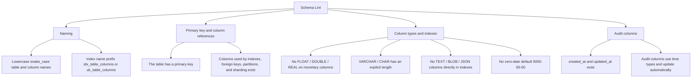

# Schema Lint

DDLBuilder has a fixed set of built-in structure rules, shown as **Schema Lint** in the app. It checks naming, primary keys, column types, indexes, and audit columns while you edit.

## When to use

When your team standardizes table design, use it to find inconsistent names, missing primary keys, floating-point types on monetary columns, and similar problems that manual reviews can miss.

---

## Rules

The built-in rules fall into four groups:

---

## Steps

1. The bottom bar of the editor shows **Schema Lint · N items** or **Schema Lint · Passed**. Click it to open the issue list. The **DDL** tab of the generated output shows the same results.
2. Review the issues:
   - Issues are sorted into three levels: **Error**, **Warning**, and **Suggestion**.
   - Each issue shows the rule name, the affected table, column, or index, the reason, and a suggested fix.
3. Fix the issues:
   - Fix **Error** items first. These are a missing primary key, or an index, foreign key, or similar setting that references a column that does not exist.
   - After you change a column or index, the results refresh immediately.

---

## Verification checklist

- [ ] Schema Lint shows no **Error** items.
- [ ] You have checked every **Warning** and **Suggestion**.
- [ ] Column names, index prefixes, and data types follow your team's conventions.

## Notes

::: tip Rules do not depend on the database type
All database types use the same rules. Switching the database type does not change them.
:::

- The check runs automatically as you edit. The missing primary key rule runs only after the table has at least one column.
- Schema Lint runs fixed rules only. For business-specific problems, also run AI Review.
