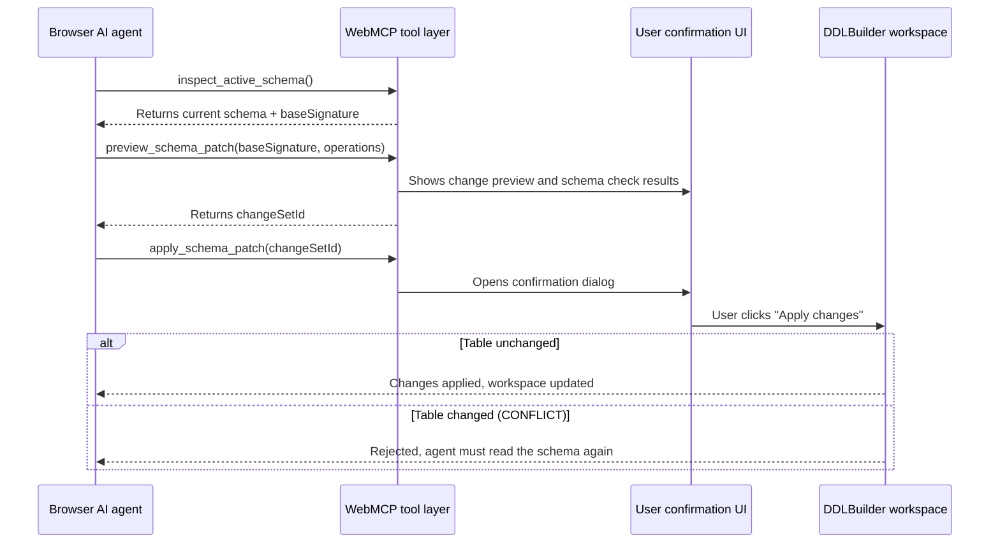

# WebMCP agent workflow

This page explains how browser AI agents can call DDLBuilder tools through **WebMCP (Web Model Context Protocol)** to read the table structure, run Schema Lint, preview SQL imports, and change the table structure after you confirm.

## When to use

When you use an AI agent in a browser that supports WebMCP (such as Chrome with experimental features turned on), the agent can read the table you are designing, run checks, or propose changes. Changes are written only after you confirm them.

---

## Tools

DDLBuilder registers the following operations as WebMCP tools. The agent calls them directly, without parsing the page DOM or taking screenshots:

| Tool name | What it does |
|---|---|
| `inspect_active_schema` | Reads one section of the current table (overview, columns, indexes, relations, or table options), up to 50 items per call, and returns a `baseSignature` |
| `lint_active_schema` | Runs Schema Lint on the current table and returns the issue list |
| `read_generated_output` | Reads the current table's generated DDL, DCL, ORM model, ALTER statements, or rollback script in chunks of up to 1,200 characters |
| `preview_schema_patch` | Takes table, column, and index changes proposed by the agent and builds a change preview without writing to the workspace |
| `import_sql_preview` | Parses SQL as the given database type and builds an import preview. It never applies automatically |
| `apply_schema_patch` | Opens a confirmation dialog and writes the previewed changes after you click **Apply changes**. If the current table changed in the meantime, it rejects the write |
| `get_auth_status` | Returns the sign-in state and the available capability groups. It does not return your email or credits |
| `start_sign_in` | Opens the sign-in dialog. You enter your password and complete human verification in the page. Only available when you are signed out |

---

## Change workflow

Agent changes are previewed first and then confirmed by you. DDLBuilder uses the table structure signature `baseSignature` to detect whether the current table has changed:

---

## Verification checklist

- [ ] The browser console can access `document.modelContext`, and the DDLBuilder tools are registered.
- [ ] The agent can read the current table's columns and indexes through the tools.
- [ ] Changes take effect only after you click **Apply changes** in the page dialog.
- [ ] On a read-only share page, the agent can read but cannot modify.

## Notes

::: warning Changes need your confirmation
Agents cannot skip the confirmation dialog to change the table structure. Every change submitted through `apply_schema_patch` is written only after you click **Apply changes**.
:::

- WebMCP is still being standardized. See the [Chrome WebMCP documentation](https://developer.chrome.com/docs/ai/webmcp) for browser support and local flags.
- WebMCP tools are registered in the open DDLBuilder tab. If you close or refresh the page, unapplied change previews are lost.
- A read-only share page registers only four read tools: `get_auth_status`, `inspect_active_schema`, `lint_active_schema`, and `read_generated_output`.
- CLI tools, CI pipelines, and cloud agents without a browser tab cannot use these tools.
