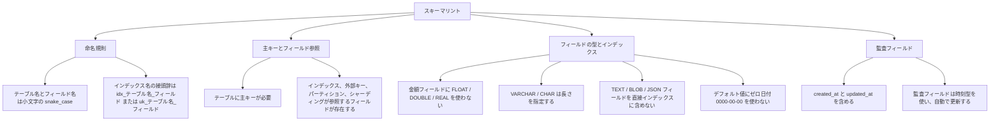

# Schema 規約チェック

DDLBuilder には固定の構造チェックルールが組み込まれており、画面上では「スキーマリント」という名前で表示されます。編集中に、命名、主キー、フィールドの型、インデックス、監査フィールドをチェックします。

## 利用場面

チームでテーブル設計の規約をそろえるときに使います。命名の不統一、主キーの欠落、金額フィールドでの浮動小数点型の使用などを見つけ、人によるレビューの見落としを減らします。

---

## チェックルール

組み込みルールは次の 4 種類に分かれます。

---

## 操作手順

1. エディターの下部に「スキーマリント · N アイテム」または「スキーマリント · 合格」と表示されます。クリックすると問題の一覧が開きます。生成結果の「DDL」タブにも同じ結果が表示されます。
2. 問題を確認します。
   - 問題は「エラー」「警告」「提案」の 3 段階の順に並びます。
   - 各問題には、ルール名、対象のテーブル・フィールド・インデックス、理由、修正の提案が表示されます。
3. 問題を修正します。
   - まず「エラー」の問題を修正します。主キーがない場合と、インデックスや外部キーなどの設定が存在しないフィールドを参照している場合です。
   - フィールドやインデックスの設定を変更すると、チェック結果はすぐに更新されます。

---

## 完了の確認

- [ ] スキーマリントに「エラー」の問題がない。
- [ ] 「警告」と「提案」をすべて 1 件ずつ確認した。
- [ ] フィールド名、インデックスの接頭辞、型の制約がチームの規約に合っている。

## 注意事項

::: tip ルールはデータベースの種類で変わらない
すべてのデータベースの種類で同じチェックルールを使います。データベースの種類を切り替えてもルールは変わりません。
:::

- チェックは編集に合わせて自動で実行されます。「主キーがありません」ルールは、テーブルにフィールドが 1 つ以上あるときにチェックされます。
- スキーマリントは固定ルールだけを実行します。業務に関わる問題は、「AIレビュー」でも確認できます。
