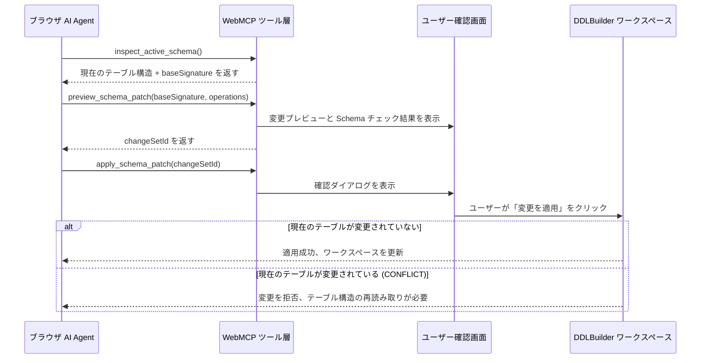

# WebMCP Agent 連携

このページでは、**WebMCP（Web Model Context Protocol）** を使って、ブラウザ内の AI Agent に DDLBuilder のツールを呼び出させる方法を説明します。Agent はテーブル構造の読み取り、スキーマリントの実行、SQL インポートのプレビューを行い、ユーザーが確認した後にテーブル構造を変更できます。

## 利用場面

WebMCP に対応したブラウザ（実験的機能を有効にした Chrome など）で AI Agent を使うと、Agent は設計中のテーブル構造を読み取り、チェックを実行し、変更を提案できます。変更はユーザーが確認した後に書き込まれます。

---

## プロトコルの機能とツール一覧

DDLBuilder は次の操作を WebMCP ツールとして登録しています。Agent はページの DOM やスクリーンショットを解析せず、これらのツールを直接呼び出します。

| ツール名 | 役割 |
|---|---|
| `inspect_active_schema` | 現在のテーブルの概要、フィールド、インデックス、リレーション、テーブルレベルのオプションを分割して読み取ります。1 回あたり最大 50 件で、`baseSignature` を返します |
| `lint_active_schema` | 現在のテーブルにスキーマリントを実行し、問題の一覧を返します |
| `read_generated_output` | 現在のテーブルから生成された DDL、DCL、ORM モデル、ALTER 文、ロールバックスクリプトを分割して読み取ります。1 回あたり最大 1200 文字です |
| `preview_schema_patch` | Agent が提案したテーブル、フィールド、インデックスの変更を受け取り、変更プレビューを生成します。ワークスペースには書き込みません |
| `import_sql_preview` | 指定したデータベースの種類で SQL を解析し、インポートプレビューを生成します。自動では適用しません |
| `apply_schema_patch` | 確認ダイアログを表示し、ユーザーが「変更を適用」をクリックした後に、プレビュー済みの変更を書き込みます。その間に現在のテーブルが変更されていた場合は、書き込みを拒否します |
| `get_auth_status` | サインイン状態と、利用できる機能グループを返します。メールアドレスとクレジットは返しません |
| `start_sign_in` | サインインダイアログを開きます。パスワードと人間による確認は、ユーザーがページ内で行います。サインインしていないときだけ提供されます |

---

## 安全な変更の流れ

Agent の変更は、まずプレビューし、その後ユーザーが確認します。DDLBuilder はテーブル構造の署名 `baseSignature` を使って、現在のテーブルが変更されたかどうかを判断します。

---

## 完了の確認

- [ ] ブラウザのコンソールで `document.modelContext` にアクセスでき、DDLBuilder が登録したツールが見える。
- [ ] Agent がツールを使って、現在のテーブルのフィールドとインデックスを読み取れる。
- [ ] 変更は、ページのダイアログでユーザーが「変更を適用」をクリックした後にだけ反映される。
- [ ] 読み取り専用の共有ページでは、Agent は読み取りだけができ、変更はできない。

## 注意事項と制約

::: warning 変更にはユーザーの確認が必要
Agent は確認ダイアログを飛ばしてテーブル構造を直接変更できません。`apply_schema_patch` で送られた変更は、毎回ユーザーが「変更を適用」をクリックした後に書き込まれます。
:::

- WebMCP はまだ標準化の途中です。ブラウザの対応状況とローカルでの有効化設定は、[Chrome WebMCP 公式ドキュメント](https://developer.chrome.com/docs/ai/webmcp)を参照してください。
- WebMCP ツールは、現在開いている DDLBuilder のタブに登録されます。ページを閉じるか再読み込みすると、適用していない変更プレビューは失われます。
- 読み取り専用の共有ページでは、`get_auth_status`、`inspect_active_schema`、`lint_active_schema`、`read_generated_output` の 4 つの読み取りツールだけが登録されます。
- CLI、CI パイプライン、ブラウザのタブを持たないクラウド Agent は、これらのツールを使えません。
