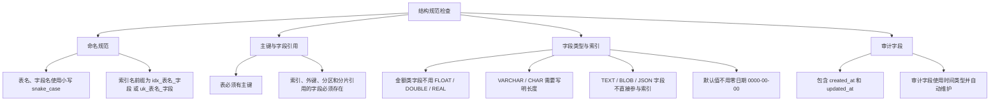

# Schema 规范检查

筑表师内置一组固定的结构检查规则，界面中名为“结构规范检查”。它在你编辑时检查命名、主键、字段类型、索引和审计字段。

## 适用场景

团队统一表设计规范时，用它找出命名不一致、缺少主键、金额字段使用浮点类型等问题，减少人工审查的遗漏。

---

## 检查规则

内置规则分为以下四类：

---

## 核心操作指引

1. 编辑区底部显示“结构规范检查 · N 项”或“结构规范检查 · 通过”，点击后展开问题列表。生成结果的“建表 DDL”标签页中也显示同一份结果。
2. 查看问题报告：
   - 问题按“错误”“警告”“建议”三级排序。
   - 每条问题列出规则名称、涉及的表、字段或索引，以及原因和修改建议。
3. 修复问题：
   - 先处理“错误”级别的问题：缺少主键，或索引、外键等配置引用了不存在的字段。
   - 修改字段或索引配置后，检查结果会立即刷新。

---

## 校验与完成标志

- [ ] 结构规范检查中没有“错误”级别的问题。
- [ ] “警告”和“建议”都已逐条确认。
- [ ] 字段命名、索引前缀与类型约束符合团队规范。

## 常见注意事项

::: tip 规则不区分数据库类型
所有数据库类型使用同一套检查规则，切换数据库类型不会改变规则。
:::

- 检查随编辑自动运行。“缺少主键”规则在表中至少有一个字段后才会检查。
- 结构规范检查只运行固定规则。与业务相关的问题，可以再用“大师评审”检查。
