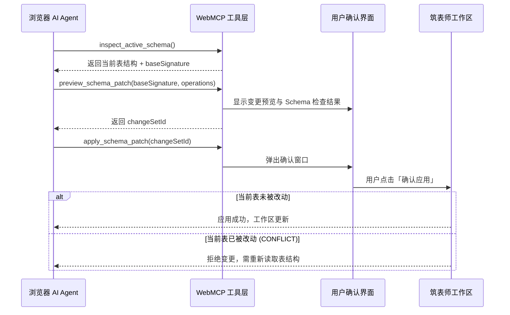

# WebMCP Agent 协作

本页介绍如何通过 **WebMCP（Web Model Context Protocol）** 让浏览器中的 AI Agent 调用筑表师的工具：读取表结构、运行结构规范检查、预览 SQL 导入，并在你确认后修改表结构。

## 适用场景

在支持 WebMCP 的浏览器（如启用了实验特性的 Chrome）中使用 AI Agent 时，Agent 可以读取你正在设计的表结构、执行检查或提出修改。修改经你确认后才会写入。

---

## 协议能力与工具清单

筑表师把以下操作注册为 WebMCP 工具。Agent 直接调用这些工具，不需要解析页面 DOM 或截图：

| 工具名称 | 作用 |
|---|---|
| `inspect_active_schema` | 分段读取当前表的概要、字段、索引、关系或表级选项，每次最多 50 条，并返回 `baseSignature` |
| `lint_active_schema` | 对当前表运行结构规范检查，返回问题清单 |
| `read_generated_output` | 分段读取当前表生成的 DDL、DCL、ORM 模型、ALTER 语句或回滚脚本，每次最多 1200 个字符 |
| `preview_schema_patch` | 接收 Agent 提出的表、字段和索引修改，生成变更预览，不写入工作区 |
| `import_sql_preview` | 按指定数据库类型解析一段 SQL，生成导入预览，不会自动应用 |
| `apply_schema_patch` | 弹出确认窗口，你点击“确认应用”后写入已预览的变更。若当前表在此期间被改动，则拒绝写入 |
| `get_auth_status` | 返回登录状态和可用的能力分组，不返回邮箱和点数 |
| `start_sign_in` | 打开登录弹窗，密码和人机验证由你在页面中完成。仅在未登录时提供 |

---

## 安全变更工作流

Agent 的修改要先预览，再由你确认。筑表师用表结构签名 `baseSignature` 判断当前表是否已被改动：

---

## 校验与完成标志

- [ ] 浏览器控制台中能访问 `document.modelContext`，并能看到筑表师注册的工具。
- [ ] Agent 能通过工具读取当前表的字段和索引。
- [ ] 变更需要你在页面弹窗中点击“确认应用”后才生效。
- [ ] 在只读分享页面，Agent 只能读取，不能修改。

## 常见注意事项与约束

::: warning 变更需要你确认
Agent 不能跳过确认窗口直接修改表结构。通过 `apply_schema_patch` 提交的每次变更，都要你点击“确认应用”后才会写入。
:::

- WebMCP 仍处于标准制定阶段。浏览器支持情况和本地开关见 [Chrome WebMCP 官方文档](https://developer.chrome.com/docs/ai/webmcp)。
- WebMCP 工具注册在当前打开的筑表师标签页中。关闭或刷新页面后，未应用的变更预览会丢失。
- 只读分享页面只注册 `get_auth_status`、`inspect_active_schema`、`lint_active_schema` 和 `read_generated_output` 四个读取工具。
- CLI、CI 流水线或没有浏览器标签页的云端 Agent 无法使用这些工具。
